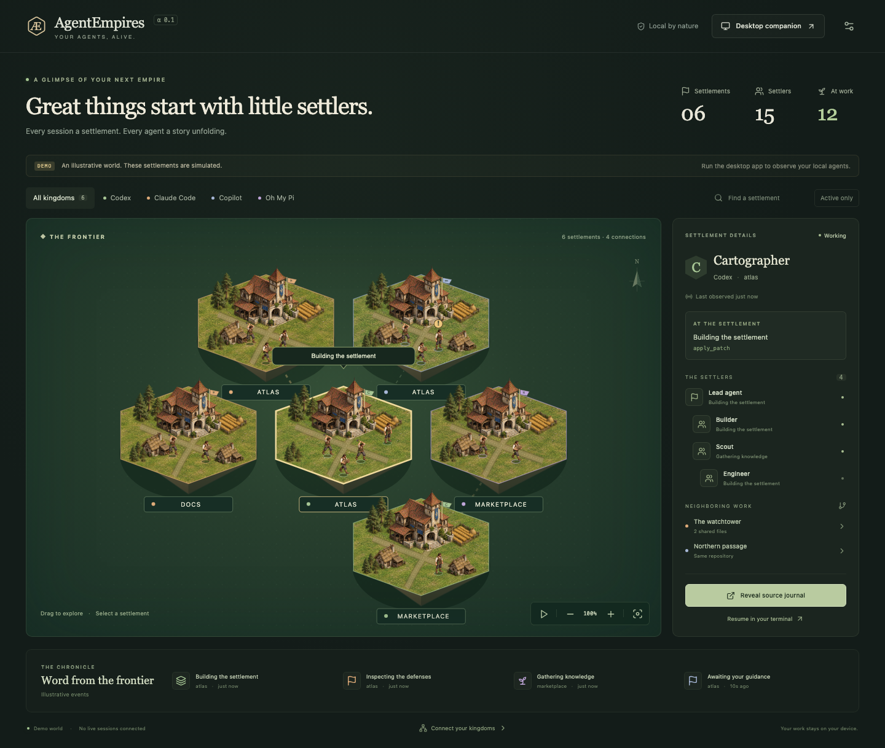

# AgentEmpires

**Your agents, alive.** A quiet desktop world for the coding agents working on your machine.

AgentEmpires turns local **Codex, Claude Code, GitHub Copilot CLI, and Oh My Pi** sessions into medieval settlements on a hex map. Each real agent becomes a settler. Reading gathers knowledge, editing builds the village, and tests inspect the defenses.



## The world

- One settlement per local CLI session, with a distinct banner color for each harness.
- Workers represent observed agents and subagents. The inspector preserves known parent relationships.
- Related repositories attract neighboring tiles. Shared file activity creates stronger connections. Git worktrees share a repository identity.
- A transparent, always-on-top desktop companion expands to the full map on double-click. The tray/menu-bar menu brings either view back.
- Search, harness filters, active-only view, pan, zoom, activity bubbles, and a local chronicle.
- Hover over a worker to see that individual agent's current activity. Demo mode and selection stay in sync between the map and companion.
- Construction grows with observed activity; it is decorative and **does not claim a percentage of task completion**.
- Reveal the original journal in Finder/Explorer, or copy a resume command for your terminal.
- Demo mode is clearly labeled and never mixed with live activity.
- Reduced-motion support and a persistent animation pause control.

## Run locally

Requirements: Node.js **24**, stable Rust, and the [Tauri desktop prerequisites](https://v2.tauri.app/start/prerequisites/). macOS needs Xcode Command Line Tools. Windows needs the Visual Studio C++ build tools and WebView2.

```sh
git clone https://github.com/dafrimer/AgentEmpires.git
cd AgentEmpires
npm ci
npm run desktop
```

Open the app, then start your CLI agents as usual. Use **Connections and settings** to change journal roots or extend the lookback from 24 hours to seven days. Environment overrides for `CODEX_HOME` and `CLAUDE_CONFIG_DIR` are honored at startup.

For the visual demo without Rust:

```sh
npm ci
npm run dev
```

The browser preview uses simulated data. Only the desktop app reads local journals.

### Build installers

```sh
# macOS: app and disk image
npm run tauri build -- --bundles app,dmg

# Windows: NSIS installer
npm run tauri build -- --bundles nsis
```

CI builds **macOS Apple Silicon, macOS Intel, and Windows x64**, runs Rust tests on all three, and uploads installers as workflow artifacts. These initial development artifacts are not notarized or publisher-signed. A public launch requires the native checklist in [release verification](docs/RELEASE.md), including signing and installation checks on both operating systems.

## Connecting the four kingdoms

| Harness     | Default journal directory  | Observed relationships                              |
| ----------- | -------------------------- | --------------------------------------------------- |
| Codex CLI   | `~/.codex/sessions`        | Subagent parent thread IDs in session metadata      |
| Claude Code | `~/.claude/projects`       | Child journals in a session's `subagents` directory |
| Copilot CLI | `~/.copilot/session-state` | Subagent lifecycle and agent IDs in `events.jsonl`  |
| Oh My Pi    | `~/.omp/agent/sessions`    | Child journals in companion artifact directories    |

On Windows, `~` means your user profile directory. Custom profiles and WSL installations need an explicitly accessible journal path. Remote, cloud, ephemeral, and desktop/IDE sessions are outside this version's scope. Codex journals explicitly marked as desktop/IDE sources are excluded.

### What “live” means

The monitor polls journals every two seconds and reads appended records incrementally. It is an **activity observer**, not a process supervisor. A recently written tool call means work was observed; it does not prove that a process is still alive. After two minutes without relevant activity, working/waiting agents become **Last seen**. Idle and closed states come from journal events. A long-running tool may therefore become Last seen until another event is written.

Journals are private harness implementation formats and may change. Some tools buffer events or do not persist subagent ancestry. AgentEmpires shows only what it can establish, never invents workers from conversation branches, and keeps adapter limitations in [the architecture notes](docs/ARCHITECTURE.md). Missing parents are not shown as independent sessions.

“Reveal source journal” reveals the file location. Focusing an arbitrary terminal tab is not portable. Resume commands are provided for use **after the original session stops**, and are never executed by AgentEmpires.

## Privacy

No accounts, hosted backend, telemetry, model API calls, or network requests in the application. Session data stays in memory. Prompts, reasoning, tool results, and command arguments are not sent to the renderer; descriptions are generated locally from tool names. Explicit session titles, repository names, local paths, and observed filenames can still be sensitive and appear locally in the UI. App settings are the only data saved by the backend. No harness settings or journals are modified.

## Development

```sh
npm test
npm run build
npx playwright install chromium
npm run test:ui
cargo test --locked --manifest-path src-tauri/Cargo.toml
```

`cargo run --manifest-path src-tauri/Cargo.toml --example inspect` prints a read-only seven-day discovery summary (counts only). The built desktop executable's `--smoke-test` option opens both native windows, checks switching, and exits; it uses isolated temporary settings and no real journal roots.

The core is Rust; the interface is React, TypeScript, and original isometric raster sprites layered in SVG inside Tauri 2. See [architecture](docs/ARCHITECTURE.md) and [contributing](CONTRIBUTING.md).

## License and artwork

MIT. Settlements use original generated isometric sprites, textured terrain, and animated villager poses inspired by classic medieval strategy games. See the [asset notes and generation prompts](public/art/README.md). No Catan or Age of Empires assets are included. AgentEmpires is an independent project, unaffiliated with the harness vendors or those games.
